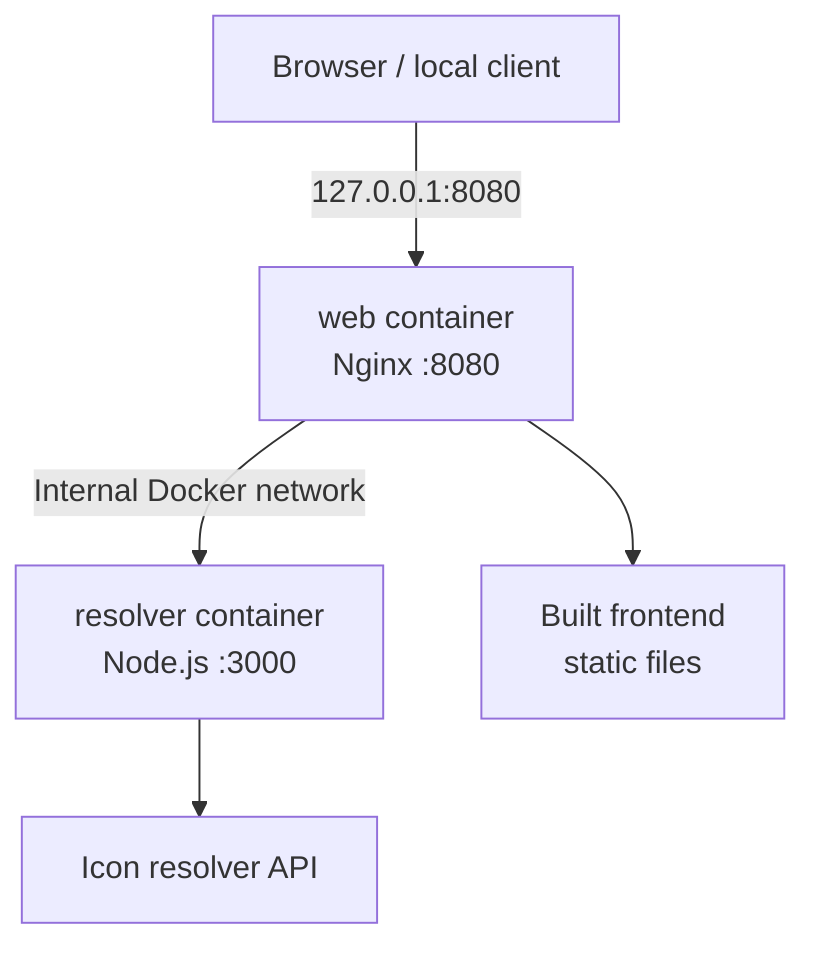

# IconFlow Docker Manual

This manual covers local development, running a published release, troubleshooting, and publishing the IconFlow container image with Docker on Windows PowerShell. Commands are intended to be run from the repository root unless noted otherwise.


## Contents

- [How the deployment works](#how-the-deployment-works)
- [Prerequisites](#prerequisites)
- [Quick start: local build](#quick-start-local-build)
- [Run a published release](#run-a-published-release)
- [Verify the application](#verify-the-application)
- [Configuration and image tags](#configuration-and-image-tags)
- [Manual `docker run`](#manual-docker-run)
- [Build and publish an image](#build-and-publish-an-image)
- [Release workflow](#release-workflow)
- [Operations and cleanup](#operations-and-cleanup)
- [Troubleshooting](#troubleshooting)
- [Security notes](#security-notes)

## How the deployment works

IconFlow is published as one image in GitHub Container Registry (GHCR). Docker Compose runs that image twice, with a different command and security context for each service.



- **web** serves the built frontend and exposes the local HTTP entry point on `127.0.0.1:8080`.
- **resolver** runs the Node.js resolver service on port `3000`. It is available to other containers on the Compose network, but is not published directly to the host.
- **health checks** let Compose determine when each service is ready. The web service waits for the resolver health check before starting.
- **one image, two roles** keeps the release artifact consistent while each container runs only its intended process.

The intended local URL is **http://127.0.0.1:8080**. The Compose project is named `iconflow`, so containers normally appear as `iconflow-web-1` and `iconflow-resolver-1`.

## Prerequisites

Install and start Docker Desktop, with Linux containers enabled. Git is needed to check out the source and create releases.

Confirm the tools are available:

```powershell
docker --version
docker compose version
git --version
```

Go to the repository root. Adjust the path if your checkout is somewhere else:

```powershell
cd D:\NeoSparkVibe\IconFlow
```

The first local build requires network access to download the Node.js base image and install npm dependencies. A published-image run requires access to GHCR; private packages also require authentication.

## Quick start: local build

Use this path when developing from the current checkout. Compose builds the image using `docker/Dockerfile`, creates the network, starts both services, and applies the runtime security settings defined in `docker/compose.yaml`.

### 1. Validate the Compose configuration

```powershell
docker compose -f docker/compose.yaml config --quiet
```

If this command reports an error, fix the YAML or configuration issue before building.

### 2. Build and start the services

```powershell
docker compose -f docker/compose.yaml up --build --detach --wait --wait-timeout 90
```

- `--build` builds the image from the local checkout.
- `--detach` runs the containers in the background.
- `--wait` waits for services to become healthy.
- `--wait-timeout 90` allows up to 90 seconds for startup.

Check the service state:

```powershell
docker compose -f docker/compose.yaml ps
```

Both services should report as running/healthy. If startup fails, inspect the logs in [Troubleshooting](#troubleshooting).

### 3. Open IconFlow

Visit [http://127.0.0.1:8080](http://127.0.0.1:8080) in your browser.

To stop the services while keeping their network and other Compose resources:

```powershell
docker compose -f docker/compose.yaml stop
```

To start them again:

```powershell
docker compose -f docker/compose.yaml start
```

## Run a published release

Use this path to run an image already published to GHCR rather than building from your working tree.

### 1. Select a version

Prefer an explicit release tag such as `1.0.0`. Avoid relying on `latest` for reproducible deployments because it can point to a different image later.

```powershell
$env:IMAGE_TAG = "1.0.0"
```

### 2. Pull and start

```powershell
docker compose -f docker/compose.yaml pull
docker compose -f docker/compose.yaml up --detach --wait --wait-timeout 90
docker compose -f docker/compose.yaml ps
```

If the package is private, authenticate with GHCR first; see [Authenticate to GHCR](#authenticate-to-ghcr).

### 3. Switch versions

Change `IMAGE_TAG` and pull again:

```powershell
$env:IMAGE_TAG = "1.0.1"
docker compose -f docker/compose.yaml pull
docker compose -f docker/compose.yaml up --detach --wait --wait-timeout 90
```

For production rollback, use a known immutable version tag or image digest rather than `latest`.

## Verify the application

### Check the HTTP entry point

```powershell
curl.exe --fail http://127.0.0.1:8080/
```

A successful request should return the application page. The `--fail` option makes curl return a non-zero exit code for HTTP error responses.

### Check the health endpoint

```powershell
curl.exe --fail http://127.0.0.1:8080/healthz
```

This endpoint verifies that Nginx is serving requests. It does not by itself prove that every application feature or upstream dependency is working.

### Inspect service state and logs

```powershell
docker compose -f docker/compose.yaml ps
docker compose -f docker/compose.yaml logs --no-color
docker compose -f docker/compose.yaml logs --follow web
docker compose -f docker/compose.yaml logs --follow resolver
```

Press **Ctrl+C** to stop following logs; this does not stop the containers.

### Test the resolver route

```powershell
curl.exe --get --data-urlencode "url=https://example.com/" http://127.0.0.1:8080/api/resolve-icon
```

The example URL is intentionally not an accepted resolver target, so an HTTP 400 response is expected. Use a supported target when testing normal resolver behavior; do not interpret this deliberate rejection as a container health failure.

## Configuration and image tags

### Image reference

The image is published under this GHCR name:

```text
ghcr.io/nameiess/iconflow:<tag>
```

Examples:

```text
ghcr.io/nameiess/iconflow:1.0.0
ghcr.io/nameiess/iconflow:sha-<commit>
ghcr.io/nameiess/iconflow:latest
```

GHCR image paths must be lowercase. The Git release tag may begin with `v`, but the Docker image tag does not: Git tag `v1.0.0` produces Docker tag `1.0.0`.

| Tag pattern | Intended use | Guidance |
| --- | --- | --- |
| `1.0.0` | Versioned release | Recommended for deployments and rollback |
| `1.0` | Minor-version alias | Moves as compatible patch releases are published |
| `1` | Major-version alias | Moves as compatible releases are published |
| `sha-<commit>` | Exact source revision | Useful for traceability |
| `latest` | Convenience alias | Mutable; do not use as a rollback reference |
| `ci` | Temporary CI build | Not intended as a production pin |

### Ports and service exposure

| Service | Container port | Host exposure |
| --- | ---: | --- |
| `web` | `8080` | `127.0.0.1:8080` |
| `resolver` | `3000` | Not published; internal Docker network only |

The host binding is intentionally limited to loopback. It makes the app available on the local machine without exposing port 8080 on every network interface.

### Resource limits

The Compose file currently sets resource limits and process limits for each service:

| Setting | web | resolver |
| --- | ---: | ---: |
| Memory limit | 128 MB | 128 MB |
| CPU limit | 1 CPU | 0.5 CPU |
| PID limit | 100 | 64 |
| Health-check interval | 30 seconds | 30 seconds |

These values are defined in `docker/compose.yaml`; edit that file if the deployment needs different limits, then validate the configuration before restarting.

## Manual `docker run`

Compose is recommended because it includes health checks, resource limits, restart behavior, and the project's complete runtime configuration. Use manual `docker run` only when you specifically need to manage the containers yourself.

The following commands use PowerShell and a published version tag.

### 1. Choose the image and create a network

```powershell
$image = "ghcr.io/nameiess/iconflow:1.0.0"
docker network create iconflow
```

If the network already exists, Docker will report that it already exists. Inspect it with `docker network inspect iconflow` rather than creating a duplicate.

### 2. Start the resolver

```powershell
docker run --detach `
  --name iconflow-resolver `
  --network iconflow --network-alias resolver `
  --user node --read-only `
  --tmpfs /tmp:rw,noexec,nosuid,size=8m `
  --cap-drop ALL `
  --security-opt no-new-privileges:true `
  --memory 128m --cpus 0.5 --pids-limit 64 `
  --restart unless-stopped `
  $image `
  node docker/resolver/server.mjs
```

The `resolver` network alias allows the web container to reach the service by its internal name. Do not publish port 3000 to the host unless you have a specific, reviewed reason to do so.

### 3. Start the web server

```powershell
docker run --detach `
  --name iconflow-web `
  --network iconflow `
  --publish 127.0.0.1:8080:8080 `
  --user nginx --read-only `
  --tmpfs /tmp:rw,noexec,nosuid,size=16m `
  --tmpfs /var/lib/nginx:rw,noexec,nosuid,size=8m `
  --cap-drop ALL `
  --security-opt no-new-privileges:true `
  --memory 128m --cpus 1.0 --pids-limit 100 `
  --restart unless-stopped `
  $image `
  nginx -g "daemon off;"
```

### 4. Verify and inspect

```powershell
docker ps
curl.exe --fail http://127.0.0.1:8080/healthz
docker logs iconflow-web
docker logs iconflow-resolver
```

To test the resolver from inside its own container:

```powershell
docker exec iconflow-resolver node -e "fetch('http://127.0.0.1:3000/healthz').then(r => { console.log(r.status); process.exit(r.ok ? 0 : 1) }).catch(e => { console.error(e); process.exit(1) })"
```

### 5. Remove the manually started containers

```powershell
docker rm --force iconflow-web iconflow-resolver
docker network rm iconflow
```

If you used Compose instead, use the Compose cleanup commands in [Operations and cleanup](#operations-and-cleanup).

## Build and publish an image

Publishing is normally handled by GitHub Actions. Use the manual steps below only when you need to build and push an image from your own machine.

### 1. Validate and build

From the repository root:

```powershell
docker compose -f docker/compose.yaml config --quiet
docker compose -f docker/compose.yaml build --pull
```

The Dockerfile uses a multi-stage build: dependencies and the frontend are built in a Node.js stage, then the runtime image contains the built frontend, Nginx configuration, and resolver server.

### 2. Apply a release tag

```powershell
docker tag ghcr.io/nameiess/iconflow:latest ghcr.io/nameiess/iconflow:1.0.0
```

Only use the command above if the local `latest` tag already points to the exact image you intend to release. Otherwise build with an explicit tag or use the repository's release helper/workflow so you do not accidentally publish a stale image.

Inspect local images before pushing:

```powershell
docker image ls ghcr.io/nameiess/iconflow
```

### Authenticate to GHCR

Create a GitHub Personal Access Token (classic) with the minimum required permissions for your task:

- `write:packages` to publish packages.
- `read:packages` to pull private packages.
- `delete:packages` only if package deletion is specifically required.

Keep the token in an environment variable or password manager. Never commit it or paste it into this manual.

In PowerShell, set the token securely for the current session, then pipe it to Docker:

```powershell
$env:GITHUB_TOKEN = "<your-token>"
$env:GITHUB_TOKEN | docker login ghcr.io -u nameIess --password-stdin
```

After the login is complete, clear the environment variable:

```powershell
Remove-Item Env:GITHUB_TOKEN
```

For production use, prefer a short-lived or narrowly scoped credential when available, and do not save credentials in scripts.

### 3. Push the image

```powershell
docker push ghcr.io/nameiess/iconflow:1.0.0
docker push ghcr.io/nameiess/iconflow:sha-<commit>
```

Replace `<commit>` with the actual source commit identifier used for the build. Push `latest` only if you intentionally want to move that convenience alias.

## Release workflow

The repository's GitHub Actions workflow is the preferred production publishing path. It builds and tests the image, performs its configured security checks, and publishes release tags using the workflow's package permissions. A local GHCR token is not needed by the workflow.

### 1. Commit intended changes

Review the diff and ensure only the intended files are staged:

```powershell
git status
git diff --check
git add docker/manual.md
git commit -m "docs: expand Docker manual"
git push origin <your-branch>
```

Merge the documentation change through your normal review process.

### 2. Create and push an annotated release tag

After the release commit is on the release branch:

```powershell
git checkout master
git pull origin master
git tag -a v1.0.0 -m "IconFlow release 1.0.0"
git push origin v1.0.0
```

Use the actual version you intend to release, and do not reuse an existing release tag. The workflow strips the leading `v` when creating the Docker tag.

For a stable release, the workflow publishes the version plus convenience aliases such as `1.0`, `1`, and `latest`. Prereleases (for example, `v1.1.0-rc.1`) receive their version and commit tags without moving stable aliases.

## Operations and cleanup

### View current services

```powershell
docker compose -f docker/compose.yaml ps
docker compose -f docker/compose.yaml top
```

### Follow logs

```powershell
docker compose -f docker/compose.yaml logs --follow --tail 100
```

### Restart after configuration changes

```powershell
docker compose -f docker/compose.yaml up --detach --force-recreate
```

If you changed the Dockerfile or build inputs, rebuild too:

```powershell
docker compose -f docker/compose.yaml up --build --detach --wait
```

### Stop or remove the stack

Stop containers but keep them:

```powershell
docker compose -f docker/compose.yaml stop
```

Stop and remove containers and the Compose network:

```powershell
docker compose -f docker/compose.yaml down
```

Remove the stack and named/anonymous volumes as well (review before using this on a stateful stack):

```powershell
docker compose -f docker/compose.yaml down --volumes --remove-orphans
```

IconFlow's current stack is intended to be stateless, but use the volume-removal option only when you are sure no data you need is stored in Docker volumes.

## Troubleshooting

| Symptom | Likely cause | What to check |
| --- | --- | --- |
| Docker commands cannot connect to the daemon | Docker Desktop is stopped or still starting | Start Docker Desktop and retry `docker info` |
| Compose configuration fails | YAML syntax or Compose version issue | Run `docker compose -f docker/compose.yaml config` and read the first reported error |
| Image pull returns unauthorized | Private GHCR package or missing credentials | Run `docker login ghcr.io` with a token that has `read:packages` |
| Container exits immediately | Invalid command, missing file, or runtime error | Run `docker compose -f docker/compose.yaml logs --no-color` |
| Web container is unhealthy | Nginx failed to start or port 8080 is unavailable inside the container | Inspect web logs and `docker compose -f docker/compose.yaml ps` |
| Port 8080 is already allocated | Another process or container is using the host port | Stop the conflicting process or change the host-side port mapping in Compose |
| Web cannot reach resolver | Resolver is unhealthy or services are not on the same network | Check both service states and resolver logs; confirm the internal resolver service name |
| Browser cannot open the site | Stack is stopped, port mapping differs, or request uses the wrong address | Check `docker compose ps` and open `http://127.0.0.1:8080` |
| Disk usage keeps growing | Old images, build cache, or logs are accumulating | Inspect `docker system df`; prune only resources you no longer need |

Useful diagnostic commands:

```powershell
docker info
docker compose -f docker/compose.yaml config
docker compose -f docker/compose.yaml ps
docker compose -f docker/compose.yaml logs --tail 200 --no-color
docker image ls
docker system df
docker network ls
```

Do not immediately run `docker system prune --all --volumes` as a troubleshooting shortcut. It can remove images, build cache, stopped containers, and unused volumes unrelated to IconFlow.

## Security notes

The Compose configuration applies several defense-in-depth controls:

- **Loopback-only publishing:** the web port binds to `127.0.0.1`, not all host interfaces.
- **Non-root processes:** Nginx and Node run as their respective non-root users.
- **Read-only root filesystem:** writable temporary paths are explicitly mounted as `tmpfs`.
- **Reduced privileges:** Linux capabilities are dropped and `no-new-privileges` is enabled.
- **Resource bounds:** memory, CPU, and process limits reduce the impact of runaway processes.
- **Health checks and restart policy:** failures are easier to detect, and Docker can restart stopped services.
- **Bounded logs:** log rotation options limit the size and number of retained log files.

These settings reduce risk but do not replace host patching, image scanning, secret management, network controls, or review of changes to the Docker configuration.

Never commit any of the following:

- GitHub tokens, passwords, private keys, or registry credentials.
- A `.env` file containing secrets.
- Local credential files or machine-specific configuration.

Before pushing a change, review it with:

```powershell
git status
git diff --check
git diff -- docker/manual.md
```

## Related files

| Path | Purpose |
| --- | --- |
| `docker/Dockerfile` | Builds the frontend and packages the runtime image |
| `docker/compose.yaml` | Defines services, networking, health checks, ports, and security settings |
| `docker/resolver/server.mjs` | Resolver service entry point |
| `docker/nginx/nginx.conf` | Nginx server configuration |
| `docker/nginx/security-headers.conf` | HTTP security headers |
| `.github/workflows/docker.yml` | Automated build, checks, and image publishing |
